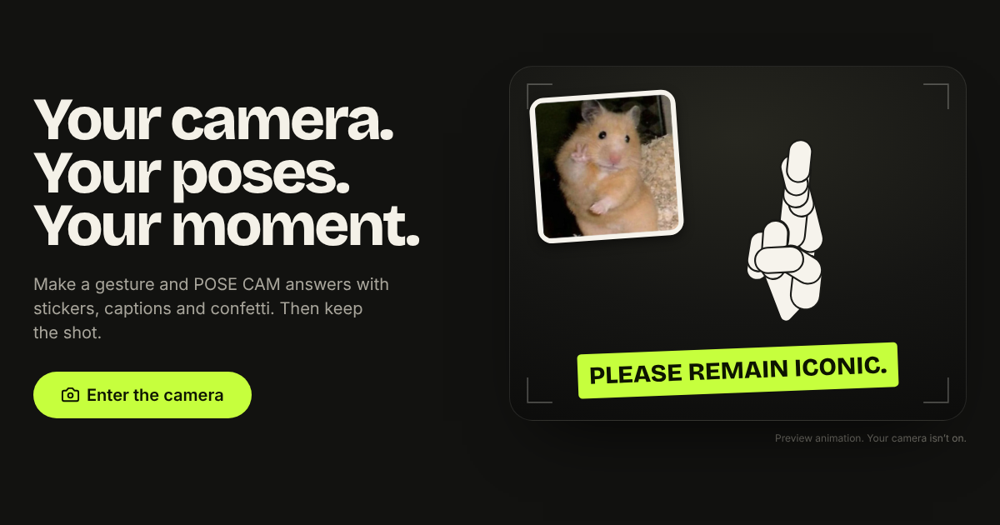
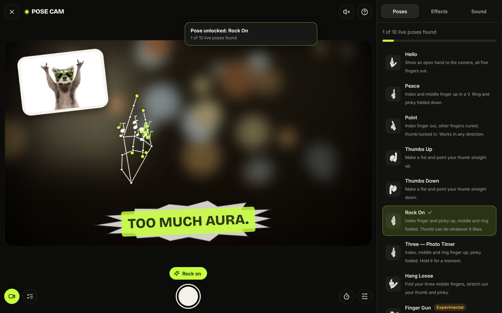
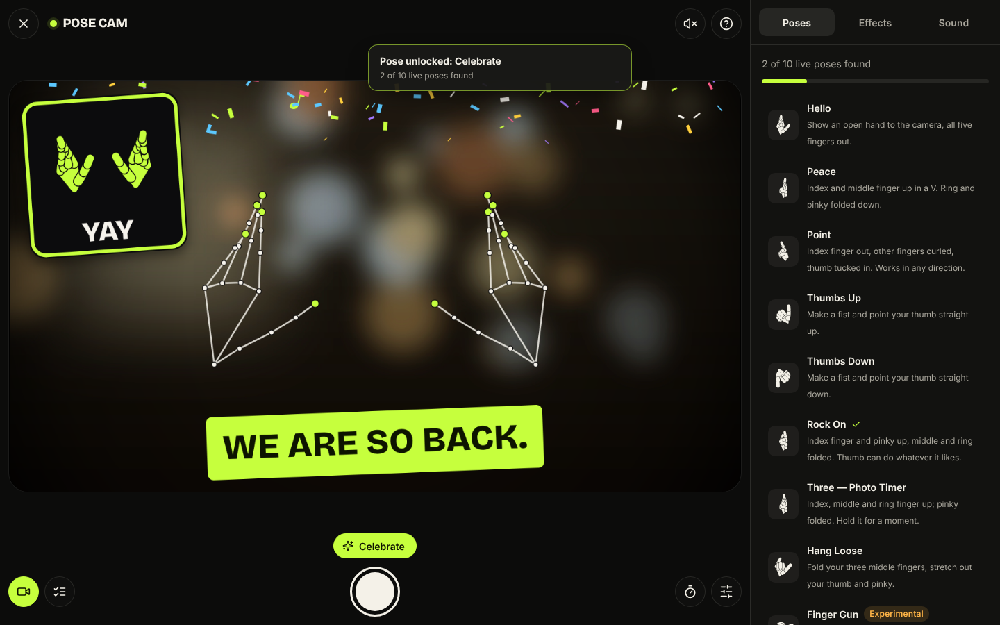
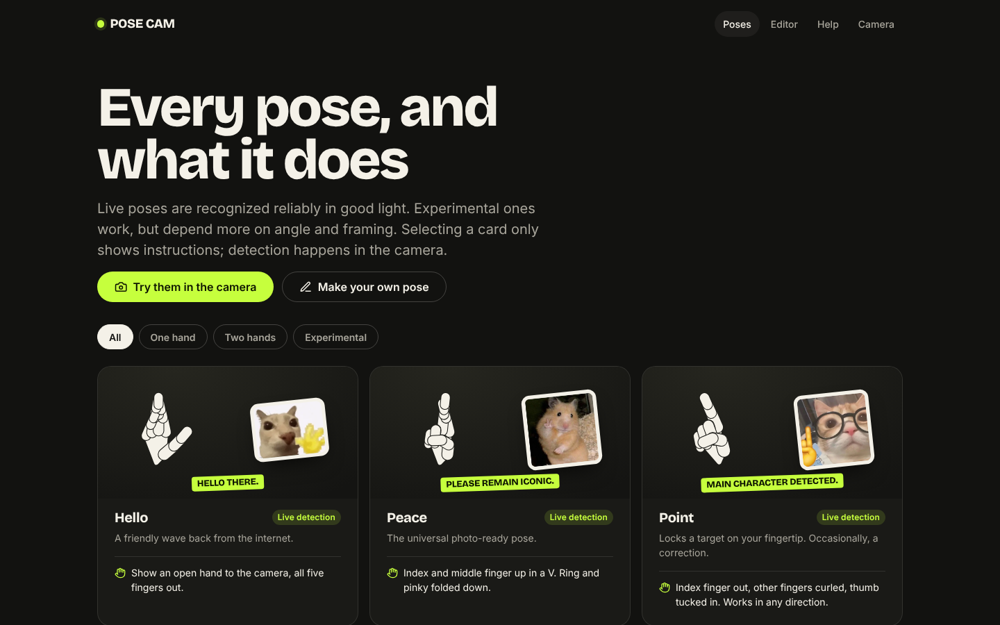
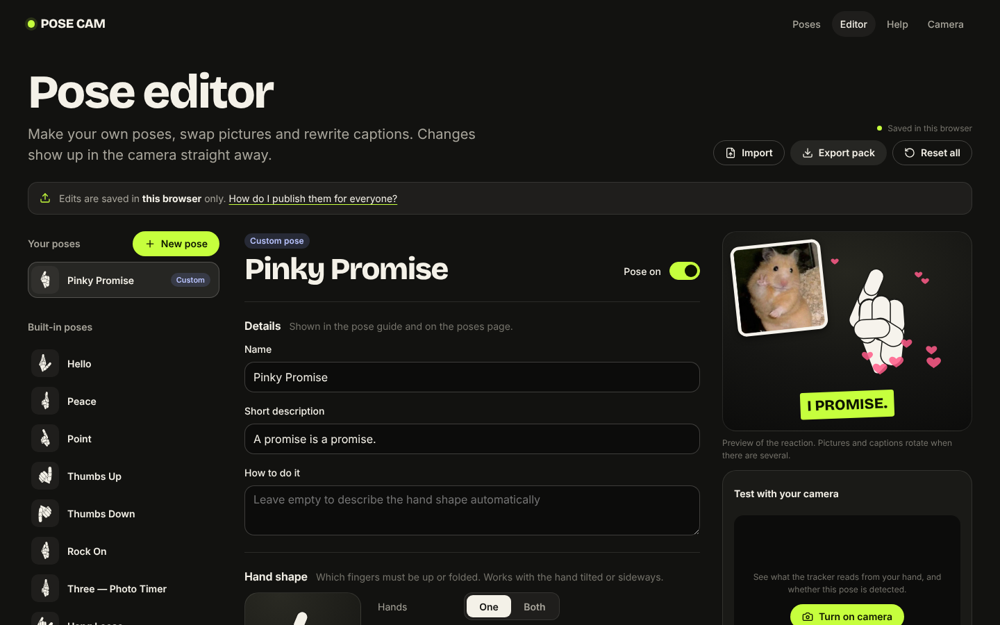

<div align="center">



<br />
<br />

# pose cam

### strike a pose. your camera answers.

<br />


<br />
<br />

[**Deploy your own**](https://vercel.com/new/clone?repository-url=https://github.com/NikhCodes/face-tracker) · [Poses](#poses) · [Pose editor](#make-your-own-poses) · [Run it locally](#run-it-locally) · [How it works](#how-it-works)

</div>

---

## a different kind of webcam toy

most gesture trackers are demos.
this one is for actually using.

open the site, turn on your camera, throw up a peace sign. a sticker pops in, a caption lands on lime tape, sparkles fly, and you can snap the moment with everything baked into the photo.

- **runs in your browser.** no install, no account, no python.
- **private by design.** hand tracking runs on your device. frames and photos never leave it.
- **14 poses built in**, and a **pose editor** to make your own, with your own pictures, captions and effects.

<table>
  <tr>
    <td width="50%"></td>
    <td width="50%"></td>
  </tr>
  <tr>
    <td></td>
    <td></td>
  </tr>
</table>

<sub>studio screenshots use a simulated hand (the skeleton) over a stand-in background, rendered by the real app.</sub>

---

## poses

| pose | how | reaction |
| --- | --- | --- |
| 👋 **hello** | open hand, all five fingers | animated wave + sparkles |
| ✌️ **peace** | index + middle up | *PLEASE REMAIN ICONIC.* |
| ☝️ **point** | index out, works in any direction | target lock on your fingertip |
| 👍 **thumbs up** / 👎 **down** | fist, thumb vertical | the council approves / disapproves |
| 🤘 **rock on** | index + pinky up | comic burst, notes, screen shake |
| 🤟 **three** | index + middle + ring | **starts a 3-second photo timer** |
| 🤙 **hang loose** | thumb + pinky out | *VIBES: IMMACULATE.* |
| 👍👍 **double thumbs** | both hands | maximum approval + spotlight |
| 🙌 **celebrate** | both hands open | confetti |
| 🔫 **finger gun** · 🤔 **thinking** · ✊✊ **rodrick** · 🫶 **heart** | *experimental* | widescreen bars, thought bubble, RODRICK!!, hearts |
| 😴 **idle** | hands down for 1.5 s | the cat waits with you |

finger poses are read from the **3D shape of your hand**, so they work upright, sideways or tilted, with either hand, mirrored or not.

---

## make your own poses

open **/admin** (the *Editor* link in the menu). it's a full pose editor:

- **new poses.** set each finger to *up*, *folded* or *any*, pick one or both hands, thumb direction and screen half. or hold the pose in front of your camera and hit **copy my hand shape**.
- **your pictures.** drag and drop images onto any pose, built-in or custom. keep or hide the originals.
- **captions, effects, sounds.** rewrite the tape text, pick confetti, hearts, stars, notes or rain, and toggle shake and spotlight.
- **switch poses off** you don't want.
- **live preview** drawn by the same renderer as the camera, plus a **camera tester** that shows exactly what the tracker sees and whether your pose matches.

changes save in your browser and show up in the camera instantly.

**publish them for everyone:** click **export pack**, save the file as `public/packs/default.json`, commit, push. every visitor gets your poses. no server, no login, no database. full format and details are in [docs/custom-poses.md](docs/custom-poses.md).

---

## run it locally

```bash
git clone https://github.com/NikhCodes/face-tracker.git
cd face-tracker
npm ci
npm run dev        # → http://localhost:5173
```

requires node 20.19+ (or 22.12+). `npm run dev` copies the MediaPipe runtime into `public/` first.

| command | does |
| --- | --- |
| `npm run dev` | dev server |
| `npm run build` | type-check + production build → `dist/` |
| `npm run preview` | serve the production build on :4173 |
| `npm test` | unit tests (vitest) |
| `npm run test:e2e` | browser tests with a fake camera (playwright, build first) |
| `npm run lint` · `npm run typecheck` | eslint · tsc |
| `npm run check` | all of the above + build |

### deploy to vercel

1. push the repo to github
2. vercel → **add new → project** → import it
3. keep the defaults and hit deploy. `vercel.json` already has the framework, routing and camera headers

no environment variables. no paid services. cameras need https, which vercel gives you.

---

## how it works

```
camera ──► web worker ──► 21 hand landmarks ──► classifier ──► stabilizer ──► reactions
(getUserMedia)  (MediaPipe,         (3D, per hand)     (joint angles,   (no flicker,     (one canvas:
                 GPU → CPU)                             thumb, position)  hysteresis)     preview = photo)
```

- **mediapipe hand landmarker** runs inside a **web worker** (wasm + webgl), so the preview stays smooth. there's a main-thread fallback.
- the **classifier** measures finger bend from joint angles in 3D, so it doesn't care how your hand is rotated. the original python version compared fingertip heights, which only worked upright.
- a **stabilizer** waits ~160 ms before showing a pose and holds it through brief tracking drops, so reactions don't flicker.
- **everything is drawn on one canvas**: camera, colour look, stickers, particles, captions. a photo is just a copy of it, so what you see is what you save.
- the model and runtime are **served from the site itself**. no cdn, no third-party requests, nothing uploaded.

deeper dive: [docs/architecture.md](docs/architecture.md)

---

## features

- **studio:** live mirrored preview, camera switching, pose guide with progress, 3-second timer (button, `T`, or three fingers)
- **looks:** original, cinematic, mono, warm, cool, plus vignette and film grain
- **photos:** png/jpeg download, native share sheet on phones, copy link
- **sound:** off by default. synthesized effects and an optional generated music loop, with no audio files
- **accessible:** keyboard shortcuts, screen-reader announcements, reduced-motion support, big touch targets
- **easter eggs:** find every live pose for a gold frame. there's also a classic code…

---

## privacy

> your camera stays on your device. pose detection happens locally in your browser. photos are created on your device and are not uploaded by pose cam.

no accounts, no analytics, no cookies. settings and custom poses live in your browser's storage. the hosting provider still sees normal web traffic (like any website). more on the in-app help page.

---

## testing

**82 unit tests** cover the classifier (each pose checked across 180 rotated, mirrored and noisy synthetic hands), the stabilizer, custom pose rules, pack validation, the editor logic, camera handling and capture.

**7 browser tests** run against the production build with chromium's fake camera:
- no camera on load
- permission denied and unsupported browser
- the full pipeline: camera, local hand tracking, photo, camera released, zero third-party requests
- the pose editor: create, reload, export, import

real-webcam checklist: [docs/testing.md](docs/testing.md)

---

## project structure

```
src/
  gestures/   classifier, stabilizer, custom pose rules, synthetic hand model
  vision/     mediapipe worker + fallback
  engine/     per-frame studio loop
  render/     canvas compositor, effects, stickers, reactions, capture
  config/     built-in poses, pose packs, live registry
  editor/     pose editor logic + camera tester
  pages/      landing, studio, poses, editor, help
public/
  models/     hand_landmarker.task
  overlays/   built-in stickers
  packs/      (optional) default.json, your published pose pack
legacy/python/  the original opencv version
```

---

## the original python version

this started as a python + opencv desktop script. it's preserved in [`legacy/python/`](legacy/python/) if you want to run it.

---

## credits

[mediapipe](https://ai.google.dev/edge/mediapipe/solutions/vision/hand_landmarker) (apache-2.0) · fonts: bricolage grotesque & inter (ofl) · icons: lucide (isc)

<sub>sticker images are internet memes carried over from the original project. their copyright belongs to their owners. swap them in the pose editor if you publish this somewhere serious.</sub>

---

<div align="center">

built by nikh &nbsp; <sub>with intention</sub>

</div>
